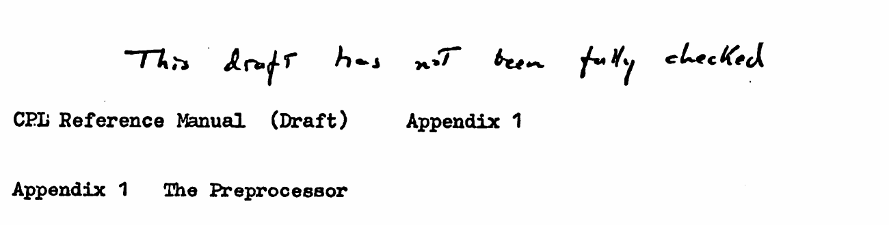
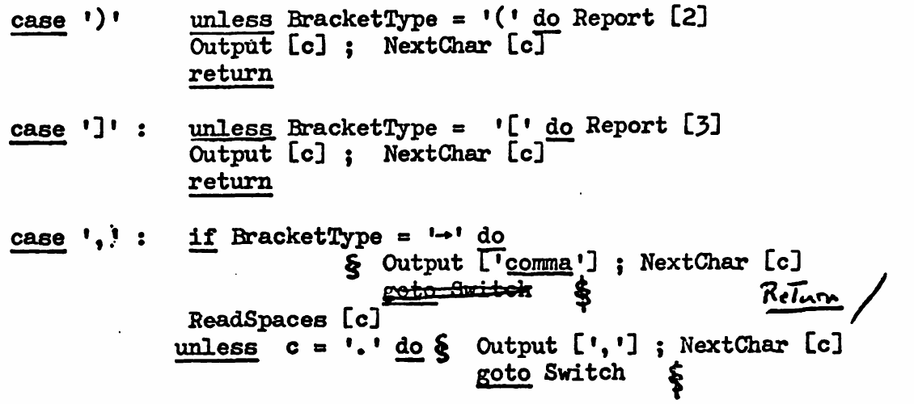

# Appendix 1: the preprocessor

The *CPL Working Papers* of July 1966 contain one CPL program of any size:
Appendix 1 of the Reference Manual draft, "The Preprocessor". It is about
190 lines, and is "intended to be both a description of the transformation
from an implementation alphabet to canonical CPL and a general example of
a CPL program". Across the top of its first page someone has written, by
hand, "This draft has not been fully checked".



This directory has that program, transcribed from the scans of pages 2 to
6 of the appendix, and running.

| File | |
| --- | --- |
| `preprocessor.cpl` | the program with its slips put right, each marked `\|\| printed:` |
| `preprocessor-as-printed.cpl` | the same with the slips as printed; it does not compile |
| `sample.pub`, `sample.out` | a small program in the implementation alphabet, and what the preprocessor makes of it |
| `itself.pub`, `itself.out` | Part 2 of the corrected program as it would be printed, and the preprocessor's output when given it |
| `itself-as-printed.pub`, `itself-as-printed.out` | the same for Part 2 as printed |

```bash
cargo build --release
target/release/cpl appendix1/preprocessor.cpl < appendix1/sample.pub
target/release/cpl appendix1/preprocessor.cpl < appendix1/itself.pub
```

`tests/appendix1.rs` runs all of this. It also holds the list of slips, as
pairs of corrected and printed text, checks that the two `.cpl` files
differ by exactly that list, and checks what each slip does when it alone
is put back.

## What the program does

It reads a CPL program a character at a time, as typed on a Flexowriter,
and writes the canonical symbols one after another, each followed by `ø`.

```text
l̲e̲t̲ a, b = 1, 2; i̲f̲ a > b g̲o̲t̲o̲ L
```

```text
letøN̸aø,øN̸bø=øK̸1ø,øK̸2ø; øiføN̸aø>øN̸bødo øgotoøN̸Lø
```

Names, numbers and strings are marked with a struck-through N, K or S.
Along the way it

- removes comments and spaces;
- puts in the `;` that the end of a line stands for, when the symbol
  before can end a command and the symbol after can start one;
- puts in the `do` that may be left out before `goto`, `break` and the
  like;
- tells a monadic `+` or `-` (`pos`, `neg`) from a dyadic one;
- joins words: `value of` becomes `valof`, `then do` becomes `do`;
- replaces the comma of a conditional expression by `comma`, and a row of
  dots in a for-list by `dot string`;
- closes the sections that a tagged closing bracket implies.

The last is done by recursion: `Preprocessor` calls itself for each
opening bracket, and is given a **label** to jump to "if a closing section
bracket is found with a tag which does not match with the current
section". The label belongs to the calling activation, so the jump
unwinds one level, which writes its own closing bracket and compares its
own tag, and so on outwards. This is the feature of section 9.3 of the
manual, used in earnest.

## The characters

An underlined letter, and a letter or sign with a stroke through it, were
single characters on the Flexowriter, typed by overstriking. Here they are
a character followed by a Unicode combining mark (U+0332 underline, U+0338
stroke), and `Readchar` returns the pair as one CPL character, so the
program's `UnderlinedLetter[c]` and `case '§̸'` work as written. `cpl
--publication FILE` prints any program in this form; that is how the
`.pub` files were made.

## What had to be supplied

Part 3 of the appendix defines thirteen of the functions that Part 2 uses
"informally", in a sentence or a list each. They are written out at the
head of `preprocessor.cpl`. Six more identifiers are used and never
mentioned: `CPL.Source`, `EndofStreamChar`, `Report`, `BigLetter`,
`SmallLetter`, and `UnderlinedLetter` with `Small.UnderlinedLetter`. They
are supplied too. `Report[n]` writes `?? Report n` and carries on, since
the program plainly expects it to return. "The basic symbol set of
canonical CPL", which `Standardizable` needs, is taken to be the list
called `Canonical`.

## The slips

These are readings of a scan of a typescript, by one reader. Each can be
checked against the page given (pages of the appendix; add 119 for the
page of the PDF, whose address is in [`sources/README.md`](../sources/README.md)),
and [`scans/`](scans) has a small detail of the page for each one. The corrections written on the copy by
hand (`:=` for `: =` throughout, `return` for `goto Switch` on page 3,
`Switch` for `Next` on page 4) are taken as part of the text and are not
counted.

Seven stop the program from compiling at all:

| | Page | As printed | Should be | What happens |
| --- | --- | --- | --- | --- |
| 1 | 2 | `ReadTag` opens `§R.T` and closes `§̸R.T.` | the same tag | no open section is tagged `R.T.` |
| 2 | 3 | `ReadUnderlinedWord` opens `§R.U.W` and closes `§̸R.U.W.` | the same tag | likewise |
| 3 | 3 | `ReadSpaces` opens `§R.S.` (the last mark is faint) and closes `§̸R.S` | the same tag | likewise |
| 4 | 3 | `Proprocessor ['§', s, Mismatch]` | `Preprocessor` | the name is not defined |
| 5 | 3 | `case ')'` with no colon | `case ')' :` | `:` expected |
| 6 | 4 | `goto switch` | `goto Switch` | a small-letter name is one letter, so this is not a label |
| 7 | 5 | `s := standard [s <=> s']` | `Standard` | the same: `standard` is eight names side by side |

A dot counts as part of a tag by the program's own rule
(`Letter.Digit.Dot`), which is why 1 to 3 are mismatches and not full
stops.

Two let it run and give the wrong answer:

| | Page | As printed | Should be | What happens |
| --- | --- | --- | --- | --- |
| 8 | 3 | `ReadUnderlinedWord` begins `s := c` | `s := ''` | the first letter of every word is taken twice: `l̲let` |
| 9 | 3 | after a comma, `ReadSpaces [c]` and then `Output [','] ; NextChar [c]` | no `NextChar` | `ReadSpaces` has already moved on, so the character after every comma is lost: `a, b = 1, 2` comes out as `a , = 1 ,` |



And in two places the informal definitions of Part 3 disagree with the
program of Part 2:

| | Page | As printed | Taken as | What happens |
| --- | --- | --- | --- | --- |
| 10 | 6 | (c) `CannotPrecedeCommand` "is true if LastOutput is any of" `;` `§` `do` `:` `or` | true if it is *none* of them | those are the symbols that can precede a command; as printed a `do` is put in after every semicolon and never where it is wanted |
| 11 | 6 | (f) `Standard` gives `go` "if x is" `goto` | no such row | (b) and (d) list `goto`, so as printed no `do` is put in before a jump |

The second kind are perhaps better called open questions than slips: Part
3 says of itself that it is informal.

One more thing is not a slip but is worth seeing. The program is written
with the switch-command, which had only just been added to the language
(its definition is on the last page of the same appendix). Part 3 was not
brought up to date with it: `jump` is not `Combinable`, so the
preprocessor, given its own text, writes `jump on` and `the rest` as two
symbols each.

## Given its own text

`itself.out` is the corrected preprocessor run on its own Part 2: 189
lines in, 1,120 canonical symbols out, ending with `finish`.

`itself-as-printed.out` is the corrected preprocessor run on Part 2 as
printed. It stops after 228 symbols, at slip 1: the closing bracket of
`ReadTag` matches no open section, every level jumps to its mismatch
label, and the outermost one is the main program's `Error: finish`. No
message is written, because the program has none for this case.

Whether the program was ever run in 1966, the documents kept here do not
say. The note at the head of it suggests that this draft, at least, was
not.
